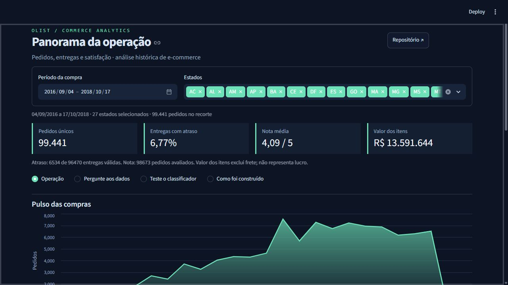
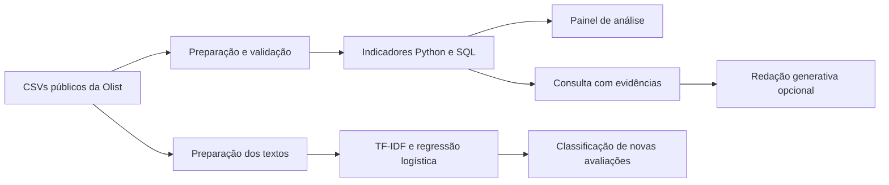

# Olist — Commerce Analytics

**Da entrega à experiência do cliente, com dados que você pode conferir.**

Explore pedidos do e-commerce brasileiro, investigue atrasos por estado e período e compare a experiência de quem recebeu no prazo com a de quem recebeu depois. O projeto conecta preparação de dados, consultas SQL, classificação de avaliações e respostas com evidências em uma aplicação interativa.



[Estudo de caso](docs/PORTFOLIO.md) · [Metodologia](docs/METODOLOGIA.md) · [Resultados de referência](reports/portfolio/example_results.json)

## O que o projeto resolve

Um pedido pode conter vários itens e receber mais de uma avaliação. Unir essas tabelas sem os cuidados adequados pode multiplicar registros e distorcer os indicadores. A preparação mantém **um registro por pedido**, agrega os itens antes da junção e seleciona uma avaliação representativa.

O resultado é um painel para explorar volume, atraso, notas e valor dos itens, com critérios de cálculo e denominadores explícitos.

## Instalação e execução

Na raiz do projeto, crie um ambiente e instale as dependências. No Windows:

```powershell
py -3.14 -m venv .venv
.\.venv\Scripts\python.exe -m pip install -r requirements.txt
.\.venv\Scripts\python.exe -m streamlit run app.py --server.port 8503 --server.showEmailPrompt false
```

Abra `http://127.0.0.1:8503`. O painel e a consulta local funcionam sem chave de API. O classificador pode ser treinado pela interface ou pelo comando descrito na seção de avaliação.

O projeto foi testado em Python 3.12 e a interface também foi executada localmente com Python 3.14. Em Linux/macOS:

```bash
python3 -m venv .venv
.venv/bin/python -m pip install -r requirements.txt
.venv/bin/python -m streamlit run app.py --server.port 8503 --server.showEmailPrompt false
```

### Dados necessários

Os CSVs da base pública estão em `data/raw/`. Para executar o painel, são usados:

| Arquivo | Uso |
|---|---|
| `olist_orders_dataset.csv` | Pedidos, situação e datas de compra/entrega |
| `olist_customers_dataset.csv` | Estado do cliente |
| `olist_order_items_dataset.csv` | Agregação do valor dos itens |
| `olist_order_reviews_dataset.csv` | Notas e textos das avaliações |

Fonte: [Brazilian E-Commerce Public Dataset by Olist](https://www.kaggle.com/datasets/olistbr/brazilian-ecommerce). São dados históricos públicos; os termos de uso estão na página da base.

## Fluxo de análise

1. **Defina o recorte:** escolha o período de compra e os estados nos filtros do topo.
2. **Investigue a operação:** em **Operação**, compare volume mensal, atrasos por estado e notas de entregas no prazo e atrasadas.
3. **Pergunte aos dados:** consulte indicadores como taxa de atraso, estado com mais atrasos ou mês com maior volume. As respostas locais citam as evidências M1–M4.
4. **Confira a origem:** abra as evidências da resposta ou exporte os indicadores por estado em CSV.
5. **Teste o classificador:** treine o modelo e informe uma avaliação para estimar a classe positiva ou negativa.

Os filtros alteram os indicadores e as evidências da consulta. O treinamento do classificador usa a base histórica completa de avaliações. A seção **Como foi construído** apresenta o fluxo de preparação, análise e modelagem.

## O que está implementado

| Recurso | Comportamento |
|---|---|
| Preparação de dados | Junções validadas, itens agregados e uma avaliação por pedido |
| Análise em SQL | Indicadores por estado, mês e situação da entrega |
| Painel interativo | Tema escuro, filtros no topo, gráficos, tabelas e exportação |
| Consulta local | Respostas por regras com referências aos agregados calculados |
| Classificação de avaliações | TF-IDF + regressão logística, comparação com baseline e inferência |
| Integração generativa opcional | Redação de respostas a partir dos mesmos indicadores agregados |
| Execução em lote | Relatório JSON de evidências e treino opcional pelo terminal |

## Resultados verificáveis

O [relatório de referência](reports/portfolio/example_results.json) registra os resultados abaixo para a base completa.

### Operação

| Indicador | Resultado |
|---|---:|
| Pedidos únicos | **99.441** |
| Entregas válidas para o cálculo de atraso | 96.470 |
| Entregas após o dia previsto | 6.534 |
| Taxa de atraso | 6,7731% |
| Nota média | 4,0864 / 5 |

O atraso compara os dias de calendário da entrega e da previsão. Registros sem datas válidas ficam fora desse denominador. A associação entre atraso e nota não estabelece causalidade. O valor dos itens exibido no painel exclui frete e não representa lucro.

### Classificador

| Critério | Resultado no teste |
|---|---:|
| Textos únicos utilizados | 30.475 |
| Textos no treino | 24.380 |
| Textos no teste | 6.095 |
| Acurácia | 0,9229 |
| F1 macro | **0,9152** |
| F1 macro da classe majoritária | 0,4004 |

Notas 1–2 representam a classe negativa; 4–5, a positiva. A nota 3 fica fora do treinamento. Textos normalizados são deduplicados antes da divisão; textos idênticos com rótulos conflitantes são excluídos. O vocabulário TF-IDF é aprendido somente no treino.

A avaliação usa divisão aleatória estratificada com semente 42. Os resultados descrevem esse protocolo em dados históricos; não validam generalização temporal ou desempenho em uma operação real. Os critérios estão detalhados na [metodologia](docs/METODOLOGIA.md).

### Reproduzir o relatório e treinar

Com o ambiente instalado, os comandos abaixo são executados na raiz do projeto:

```powershell
.\.venv\Scripts\python.exe -m olist_insights
.\.venv\Scripts\python.exe -m olist_insights --train
```

O primeiro gera `reports/portfolio/results.json` com as evidências. O segundo também treina e avalia o classificador e salva `models/reviews.joblib`. O diretório do modelo é criado pelo treinamento e fica fora do Git.

## Consulta com IA opcional

A consulta local já responde às perguntas suportadas usando regras e SQL fixo. Para habilitar a redação generativa, configure `OPENAI_API_KEY` e `OPENAI_MODEL` no ambiente do servidor:

```powershell
$env:OPENAI_API_KEY = "sua-chave"
$env:OPENAI_MODEL = "modelo-disponivel-na-sua-conta"
.\.venv\Scripts\python.exe -m streamlit run app.py --server.port 8503 --server.showEmailPrompt false
```

Selecione **IA generativa (OpenAI)** e autorize o envio da pergunta e dos indicadores agregados. O aplicativo não carrega `.env` automaticamente. Mantenha a chave fora do repositório.

São enviados a pergunta e os agregados; comentários de clientes, identificadores e CSVs não são transmitidos. A integração usa `store=False`. As chamadas podem consumir créditos da API, e as evidências continuam disponíveis para conferir o texto produzido. Consulte o [funcionamento do assistente](docs/PROMPTS.md).

A integração generativa é testada com cliente simulado. Os resultados do classificador e da análise não medem a qualidade de um LLM externo.

## Testes

```powershell
.\.venv\Scripts\python.exe -m pip install -r requirements-dev.txt
.\.venv\Scripts\python.exe -m pytest -q
```

**24 testes** cobrem preparação dos dados, junções, datas, denominadores, filtros, respostas locais, contrato da integração generativa, classificação de avaliações e navegação do painel. O fluxo de testes no GitHub está em [`.github/workflows/tests.yml`](.github/workflows/tests.yml).

## Arquitetura



| Caminho | Responsabilidade |
|---|---|
| `app.py` | Interface, filtros, gráficos, consultas e teste do classificador |
| `olist_insights/analytics.py` | Preparação dos pedidos, indicadores e consultas SQL |
| `olist_insights/assistant.py` | Consulta local e integração generativa |
| `olist_insights/sentiment.py` | Treinamento, avaliação e inferência |
| `olist_insights/__main__.py` | Relatório reexecutável e treinamento opcional |
| `tests/` | Verificação dos dados, modelo, respostas e interface |
| `src/` e `notebooks/` | Scripts e análises acadêmicas originais |

## Documentação e contexto

- [Estudo de caso: problema, decisões e resultados](docs/PORTFOLIO.md)
- [Metodologia dos indicadores e da classificação](docs/METODOLOGIA.md)
- [Consulta local e integração generativa](docs/PROMPTS.md)
- [Relatório de referência](reports/portfolio/example_results.json)

Projeto de origem acadêmica, desenvolvido com apoio de IA e dados públicos históricos. O painel permite explorar os critérios de cálculo e reproduzir os resultados. O tempo da execução em lote é medido na máquina utilizada; economia de horas de trabalho não foi medida.
