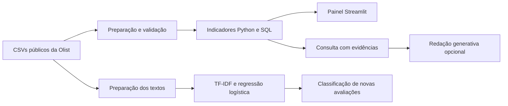

# Estudo de caso — entregas e satisfação no e-commerce

## Contexto

O dataset público da Olist reúne pedidos, itens, clientes e avaliações do e-commerce brasileiro. O projeto transforma essas tabelas em indicadores exploráveis e conecta a análise operacional a um modelo de classificação de avaliações.

## Problema

A análise de atrasos e satisfação exige cuidado com a estrutura dos dados: um pedido pode conter vários itens e mais de uma avaliação. Junções sem agregação podem multiplicar registros e distorcer as métricas.

A solução mantém um registro por pedido, explicita os denominadores e permite investigar diferenças por estado e período.

## Solução implementada

- **Preparação em Python:** validação das junções, agregação de itens e seleção de uma avaliação por pedido.
- **Indicadores e SQL:** volume de compras, taxa de atraso, nota média, valor dos itens e comparações por estado e mês.
- **Painel interativo:** filtros de data e estado, gráficos, tabelas e exportação de indicadores.
- **Classificação de avaliações:** TF-IDF e regressão logística com separação de treino/teste e comparação com baseline.
- **Consulta com evidências:** respostas locais vinculadas aos indicadores M1–M4 e integração generativa opcional para redigir respostas a partir dos mesmos agregados.

## Decisões de implementação

| Decisão | Motivo |
| --- | --- |
| Agregar itens antes de unir as tabelas | Preservar a contagem de pedidos e evitar duplicação de valores. |
| Comparar o dia previsto e o dia de entrega | Definir o atraso por calendário, incluindo o dia previsto como prazo válido. |
| Excluir entregas sem datas válidas do denominador | Evitar classificar registros incompletos como pontuais. |
| Separar quantidade e taxa de atrasos | Distinguir volume operacional de proporção de entregas atrasadas. |
| Deduplicar textos antes de separar treino/teste | Reduzir vazamento de textos idênticos entre as partições. |
| Comparar o classificador com uma previsão majoritária | Avaliar o ganho em relação a uma referência simples. |
| Usar consultas SQL fixas e evidências agregadas | Tornar os cálculos rastreáveis e evitar executar código gerado pelo modelo. |

## Resultados técnicos

Execução de referência com os dados do repositório:

| Indicador | Resultado |
| --- | ---: |
| Pedidos únicos | 99.441 |
| Entregas válidas para análise de atraso | 96.470 |
| Entregas após o dia previsto | 6.534 |
| Taxa de atraso | 6,7731% |
| Textos únicos usados no classificador | 30.475 |
| Textos reservados para teste | 6.095 |
| Acurácia no teste | 0,9229 |
| F1 macro no teste | 0,9152 |
| F1 macro do baseline majoritário | 0,4004 |

A avaliação usa divisão aleatória estratificada com semente 42. Os resultados descrevem esse protocolo e devem ser interpretados com os critérios da [metodologia](METODOLOGIA.md). Os valores e agregados podem ser conferidos no [relatório de referência](../reports/portfolio/example_results.json).

## Fluxo de uso

1. Selecionar um período de compra e os estados de interesse.
2. Comparar volume, atraso e notas na visão dos pedidos.
3. Consultar uma pergunta e conferir as evidências usadas na resposta.
4. Inserir uma avaliação nova no classificador e analisar a classe estimada e o escore.

## Arquitetura

## Documentação técnica

- [Instalação e execução](../README.md#instalação-e-execução)
- [Metodologia e avaliação](METODOLOGIA.md)
- [Funcionamento do assistente e plano de avaliação generativa](PROMPTS.md)
- [Testes automatizados](../tests/)

O projeto tem origem acadêmica e utiliza dados históricos públicos. A integração generativa é opcional; seus testes de contrato e requisitos de configuração estão descritos na documentação técnica.
